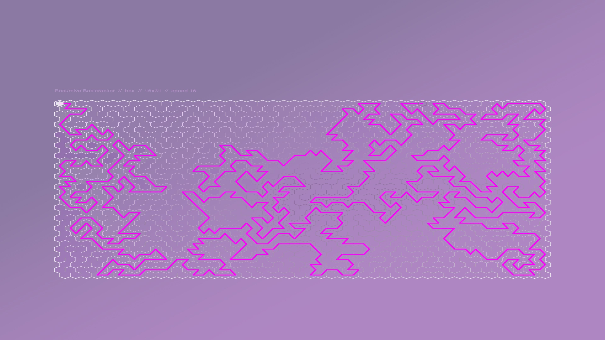

# mazes-ASK

Maze generation algorithms

Formerly `mazeASK`. The repository was renamed in place on 2026-11-21, and its old GitHub address redirects here.

---

## Live maze lab

[mazes.A-S-K.studio](https://mazes.a-s-k.studio/)

Eight algorithms build mazes on four grids while you watch, with full window, fullscreen, fixed frames and PNG saves at exact sizes. The maze lab is a browser instrument on [design-system-ASK](https://github.com/apexSolarKiss/design-system-ASK)'s instrument pattern, served from [`web/`](web/); there is no build step. See [`web/README.md`](web/README.md) for its controls, keys and how it differs from the earlier sketch.

---

## What this is

An interactive lab for exploring maze generation algorithms through their behavior and output.

Switch between algorithms and watch how each one builds structure in real time.

Same grid. Same constraints. Different rules.

## Why this repo exists

mazes-ASK is an expression of intent on three layers >>

- artistic purpose: [docs/intent/artistic-purpose.md](docs/intent/artistic-purpose.md)
- didactic purpose: [docs/intent/didactic-purpose.md](docs/intent/didactic-purpose.md)
- workflow experiment: [docs/intent/workflow-experiment.md](docs/intent/workflow-experiment.md)

---

## Earlier p5.js sketch

The maze lab began as a p5.js sketch, [`mazeASK.js`](mazeASK.js), kept in this repository as provenance. The live maze lab keeps its algorithms, palette and drawing, repairs three algorithm rules that left some mazes in pieces, and changes how saving, output sizes and some keys work. The Architecture, Controls and Topology mode sections below describe the sketch.

---

## Architecture

`mazeASK.js` is structured as a single p5.js sketch with three phases >> initialization, incremental generation, and rendering. The `step...()` functions contain the algorithm-specific generation logic.

For the conceptual generalization path from rectangular mazes to topology-owned structure, see [docs/didactic/generalization-narrative.md](docs/didactic/generalization-narrative.md).

---

## Algorithms

- Recursive Backtracker  
- Binary Tree  
- Prim  
- Sidewinder  
- Eller  
- Kruskal  
- Wilson  
- Aldous–Broder  

See [docs/didactic/algorithm-notes.md](docs/didactic/algorithm-notes.md) for a breakdown of each algorithm and what it produces.

---

## Key idea

All of these are doing the same thing >>

building a spanning tree.

What changes is how the next connection is chosen.

That choice introduces bias.  
That bias shapes the structure.  
That structure is what you see.

---

## Controls

These are the p5.js sketch's controls. The live maze lab's controls and keys are in [`web/README.md`](web/README.md): it saves only from its `save PNG` button, its frame selector replaces `o` and `p`, and `P` pauses building.

### Algorithms
- `1` Recursive Backtracker  
- `2` Binary Tree  
- `3` Prim  
- `4` Sidewinder  
- `5` Eller  
- `6` Kruskal  
- `7` Wilson  
- `8` Aldous–Broder  

### Interaction
- `click` save PNG output  
- `e` toggle start + finish overlay  
- `s` toggle solution path overlay  
- `space` regenerate  
- `r` recolor  
- `h` toggle rectangular / hex topology  
- `c` toggle rectangular / radial topology  
- `t` toggle rectangular / triangle topology  
- `-` / `+` adjust speed  

### Density
- `[` decrease grid  
- `]` increase grid  

### Output
- `o` toggle output mode  
- `p` cycle square / `4:3` / widescreen  

---

## Topology mode

This describes the p5.js sketch. The live maze lab offers the same grids and repairs Binary Tree on hexagons and rings, and Wilson; see [`web/README.md`](web/README.md).

Rectangular is the default baseline.

Hex is opt-in through the `H` toggle and currently works for >>
- Recursive Backtracker
- Binary Tree
- Prim
- Aldous–Broder
- Wilson
- Kruskal

Radial is opt-in through the `C` toggle and currently works for >>
- Recursive Backtracker
- Binary Tree
- Prim
- Aldous–Broder
- Wilson
- Kruskal

Radial does not yet claim support for >>
- Sidewinder
- Eller

Triangle is opt-in through the `T` toggle and currently works for >>
- Recursive Backtracker
- Binary Tree
- Prim
- Aldous–Broder
- Wilson
- Kruskal

Sidewinder and Eller remain rectangular-only for now.

---

## License

Copyright 2026 Andrew S Klug // ASK

Licensed under the Apache License 2.0 // see [`LICENSE`](LICENSE)

`web/` also includes design-system-ASK files (Apache License 2.0) and the Inter and JetBrains Mono fonts (SIL Open Font License 1.1); see [`web/VENDOR.md`](web/VENDOR.md).
